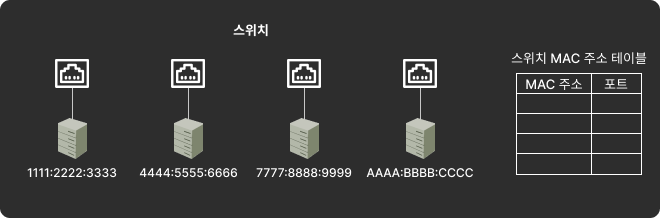
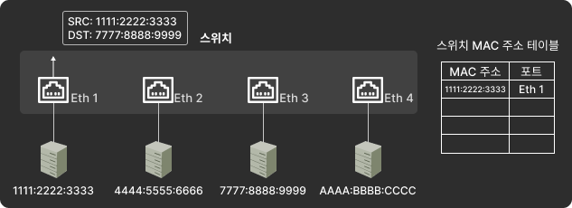
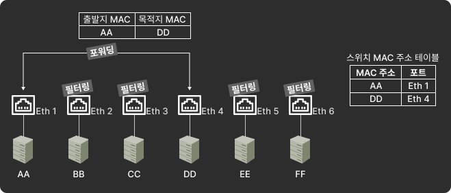

# 0. 개괄
2계층 주소인 MAC 주소를 기반으로 동작하며 통신을 중재하는 장비
- 네크워크 중간에서 패킷을 받아 필요한 곳에만 보내줌 
- 패킷을 동시에 여러 장비가 서로 간섭 없이 도와주는 장비

스위치의 핵심 역할은 누가 어느 위치에 있는지 파악하고 패킷을 정확하게 전송하는 것
- 2계층 주소를 알고 있음
- MAC 주소 테이블이 있기에 가능함
  - 스위치 포트 번호와 해당 포트에 연결돼 있는 컴퓨터의 MAC 주소가 등록된 데이터베이스

---

# 1. 플러딩(Flooding)
스위치는 부팅하면 네트워크 관련 정보는 존재하지 않고 허브처럼 동작
- 허브는 패킷이 들어온 포트를 제외하고 모든 포트로 패킷을 전달
- 이런 동작 방식을 플러딩이라고 한다.

[이미지 출처](https://chaeyami.tistory.com/196)

패킷이 스위치에 들어오면 해당 패킷 정보의 MAC 주소를 보고 학습
- 학습한 것을 바탕으로 MAC 주소 테이블을 만들고 이를 통해 패킷을 전송

---

# 2. 어드레스 러닝(Address Learning)
MAC 주소 테이블을 만들고 유지하는 과정
- 패킷의 출발지 MAC 주소 정보를 이용
- 스위치에 해당 패킷의 출발지 MAC 주소와 포트 번호를 MAC 주소 테이블에 기록
- 출발지의 MAC 주소 정보를 사용하므로 목적지 MAC 주소 필드에서만 사용하는 브로드캐스트나 멀티캐스트에 대한 MAC 주소를 학습할 수는 없음

[이미지 출처](https://chaeyami.tistory.com/196)

---

# 3. 포워딩, 필터링 (Forwarding, Filtering)
도착지 MAC 주소를 확인하고 자신이 갖고 있는 정보와 매칭하는 포트로 패킷을 전송함
- 매칭된 포트로 패킷을 보내는 것을 포워딩
- 매칭되지 않은 포트로 보내지 않는 것을 필터링이라고 함

[이미지 출처](https://chaeyami.tistory.com/196)

스위치는 일반적으로 유니캐스트에 대해서만 포워딩과 필터링 작업을 수행한다.

