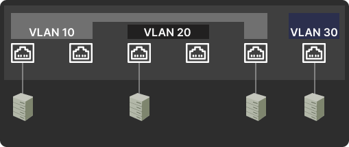
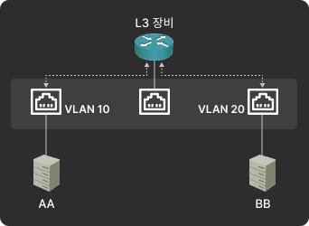
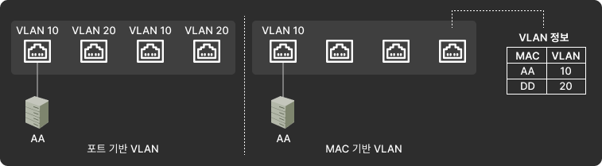
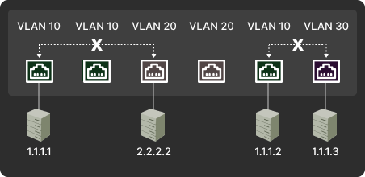
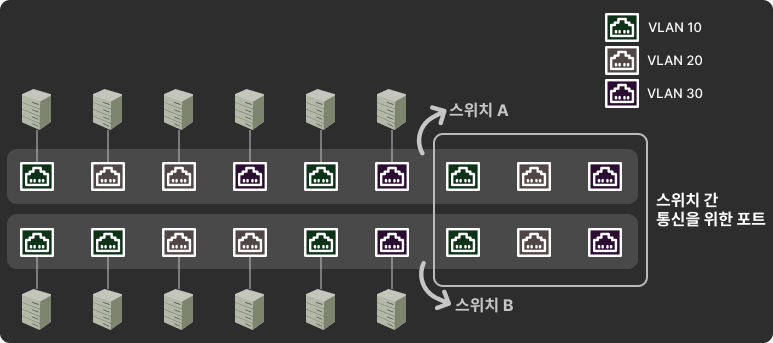
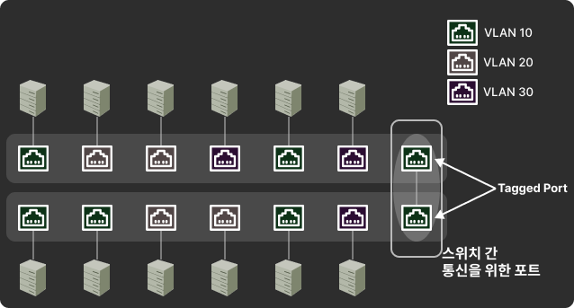
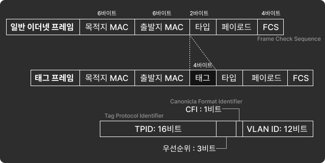
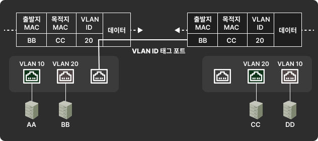
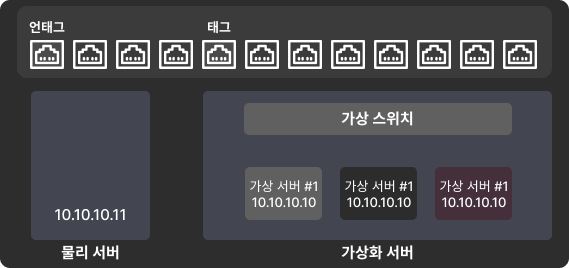

# 1. VLAN 이란?
물리적 배치와 상관없이 LAN 을 논리적으로 분할, 구성하는 기술
- 다수의 단말이 네트워크에 연결될 때, 과도한 브로드캐스트로 인한 성능, 보안 문제를 해결

[이미지 출처](https://chaeyami.tistory.com/197?category=1232951)

VLAN 을 나누면 유니캐스트뿐만 아니라 브로드캐스트도 VLAN 간에 통신이 불가능함
- 만약 VLAN 간 통신이 필요하다면 3계층 장비(라우터)를 이용해야 함

[이미지 출처](https://chaeyami.tistory.com/197?category=1232951)

---

# 2. VLAN 의 종류와 특징
VLAN 할당 방식에는 **(1) 포트 기반** **(2) 주소 기반** 으로 나뉨

    
[이미지 출처](https://chaeyami.tistory.com/197?category=1232951)

### 포트 기반
스위치를 논리적으로 분할해 사용하는 것이 목적
- 스위치의 포트를 VLAN 으로 나누어 사용
- 우리가 일반적으로 언급하는 대부분의 VLAN
- 어떤 단말이 접속하든지 스위치의 특정 포트에 VLAN 을 할당하면 할당된 VLAN 에 속함

### 주소 기반
스위치의 고정 포트가 아닌, 스위치에 연결되는 단말의 MAC 주소를 기반으로 VLAN 을 할당
- 사용자들의 자리 이동 등이 문제
- VLAN 선정 기준이 PC 의 MAC 주소

---

# 3. VLAN 모드(Trunk, Access) 동작 방식
VLAN 간 통신이 불가능하기에 3계층 장비가 필요

    
[이미지 출처](https://chaeyami.tistory.com/197?category=1232951)

여러 VLAN 이 존재한느 상황에서 스위치를 서로 연결해야 하는 경우
- 각 VLAN 끼리 통신하기 위해서는 VLAN 개수만큼 포트를 연결
- VLAN 으로 분할된 스위치는 물리적으로 별도의 스위치 처럼 취급한다.

        
[이미지 출처](https://chaeyami.tistory.com/197?category=1232951)

위의 그림처럼 스위치에 3개의 VLAN 이 구성된 경우
- 각 VLAN 이 스위치 간에 통신하기 위해서 3개의 포트 필요
- VLAN 을 더 많이 사용하는 중-대형 네트워크에서는 이렇게 연결하면 장비간의 연결만으로도 많은 포트가 낭비됨

    
[이미지 출처](https://chaeyami.tistory.com/197?category=1232951)

위 문제를 해결하기 위해 VLAN 태그 기능을 사용
- 하나의 포트에 여러 개의 VLAN 을 함께 전송할 수 있음
- 이 포트를 **태그(Tagged) 포트** 혹은 **트렁크(Trunk) 포트** 라고 함

    
[이미지 출처](https://chaeyami.tistory.com/197?category=1232951)

위 그림처럼 기존 이더넷 프레임에 VLAN ID 필드를 끼우면 태그 프레임이 된다.

태그 포트를 사용하면 VLAN 마다 통신하기 위해 필요한 여러 포트를 하나로 묶어서 사용 가능
- 이 방식을 사용하면 스위치의 MAC 주소 테이블에도 변화가 생긴다.
- 다른 VLAN 끼리는 통신하지 못하도록 MAC 테이블에 VLAN 을 지정하는 필드가 추가되는 것

1. 일반적이 포트
   - 하나의 VLAN 에 속한 경우에만 사용
   - 하나의 네트워크에 속한 서버의 경우 언태그로 설정
2. 태그(트렁크) 포트
   - 여러 VLAN, 여러 네트워크를 하나의 물리적 포트로 전달하는데 사용
   - 여러 네트워크가 동시에 설정된 스위치 간의 연결에서 사용

[이미지 출처](https://chaeyami.tistory.com/197?category=1232951)

스위치 간의 연결이 아닌, 서버와 연결된 포트도 가상화 서버가 연결될 때는 VLAN 과 통신해야할 떄가 있음
- 이런 경우 서버와 연결된 스위치의 포트라 하더라도 태그로 설정한다
- 이 대, 가상화 서버쪽 인터페이스에서도 태그된 상태로 설정한다.

[이미지 출처](https://chaeyami.tistory.com/197?category=1232951)